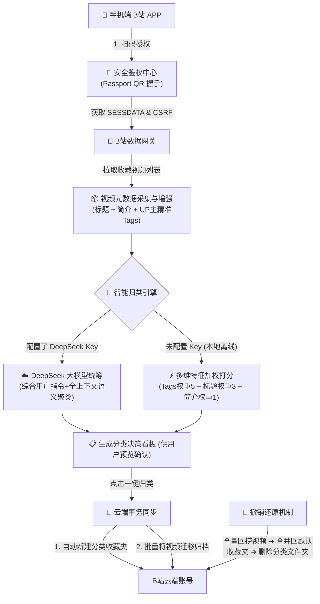

# BiliSort · 哔哩哔哩智能收藏夹整理助手 ✨

<div align="center">


### 让杂乱无章的 B 站收藏夹一键重获新生 🚀

[](https://www.python.org/)
[](LICENSE)
[](https://github.com/TomSchimansky/CustomTkinter)
[](https://www.deepseek.com/)

</div>

---

## 🌟 核心特性

- 📱 **安全免密扫码登录**：基于 B 站官方 Passport 二维码协议，手机 APP 扫码即可授权，绝不索要账号密码。
- 🤖 **双引擎智能归类**：
  - **DeepSeek 大模型全局意图理解**：结合用户挑选的文件夹主题、自定义需求说明及视频的标题、UP主与官方标签，大模型全局统筹自主归档。
  - **本地多维加权打分（免 API Key）**：无大模型 Key 也能离线极速运行！结合官方标签（权重5）、标题（权重3）与简介多维加权自动匹配。
- 💡 **精选主题灵感超市**：告别刻板“身份预设”，内置数十种涵盖编程、AI、考公考研、数码搞机、理财投资、影音娱乐的精简主题，点击直接添加，亦可随时手打自定义主题。
- 🏷️ **标签云与胶囊交互**：选中的文件夹支持一键移除（`✕`）与实时增删，所见即所得。
- 🚀 **官方云端事务批量归纳**：自动在 B 站创建分类文件夹，并将视频批量安全分片复制归档。
- 🧹 **一键撤销与安全还原**：随时可一键撤销！系统自动将分类文件夹中的所有视频完整合并搬回【默认收藏夹】（确保收藏永不丢失），并从 B 站清理分类文件夹。
- 🎨 **现代视觉暗色设计**：采用哔哩哔哩经典粉蓝元气主题（`#FB7299` / `#00AEEC`），搭配 CustomTkinter 流畅动效与 3D 精致图标。

---

## 🛠️ 系统架构与工作原理



---

## 🚀 快速开始

### 方式一：直接运行打包好的桌面程序（推荐）
在 Windows 电脑上直接运行 release 中的 `BiliSort.exe`：
- 免安装 Python，双击即开即用！
- *(如遇到 Windows SmartScreen 提示，点击「更多信息」->「仍要运行」即可)*

### 方式二：从源码运行

1. **克隆项目到本地**：
   ```bash
   git clone https://github.com/your-username/BiliSort.git
   cd BiliSort
   ```

2. **安装依赖**：
   ```bash
   pip install -r requirements.txt
   ```

3. **启动图形界面**：
   ```bash
   python app_gui.py
   ```

4. **独立构建打包成单个 .exe**：
   ```bash
   pyinstaller --noconsole --onefile --name "BiliSort" --icon "app_icon.ico" --add-data "app_icon.png;." --add-data "app_icon.ico;." --collect-all customtkinter --collect-all PIL app_gui.py
   ```

---

## 🔒 隐私与安全声明

- **本地存储**：您的登录凭证（Cookies）和 API Key 仅保存在您本地设备上（`bilibili_cookie.json` 和 `app_config.json`），绝不上传到任何第三方服务器。
- **开源透明**：本项目代码完全开源透明，接受社区监督。
- **免责声明**：本项目仅供个人学习、研究与整理收藏夹使用，严禁用于任何商业目的或恶意爬虫。

---

## 📄 开源许可证

本项目采用 [MIT License](LICENSE) 开源许可证。
